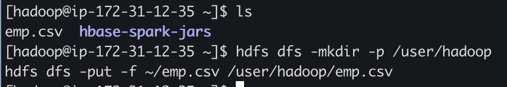
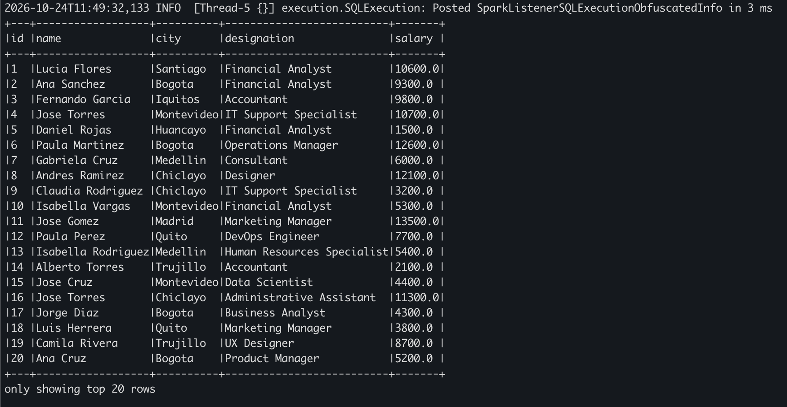
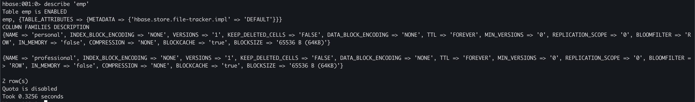
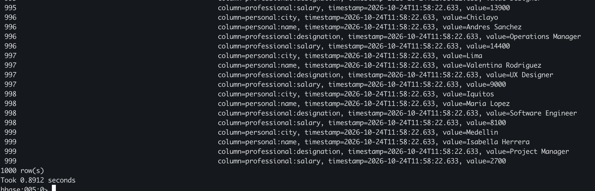
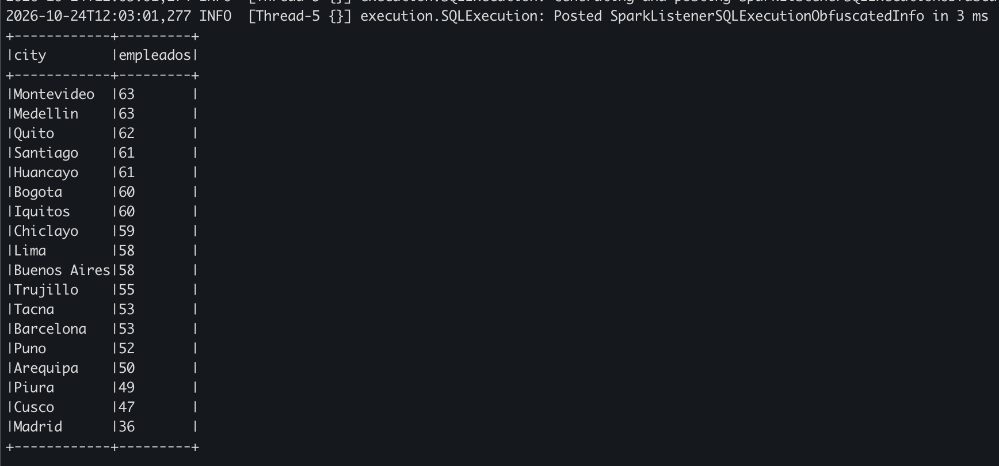
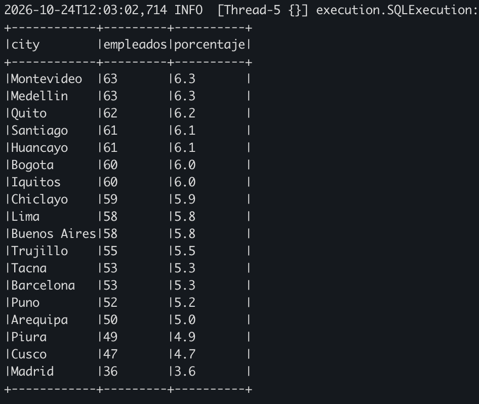
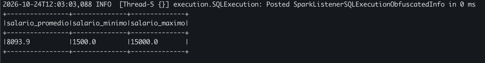
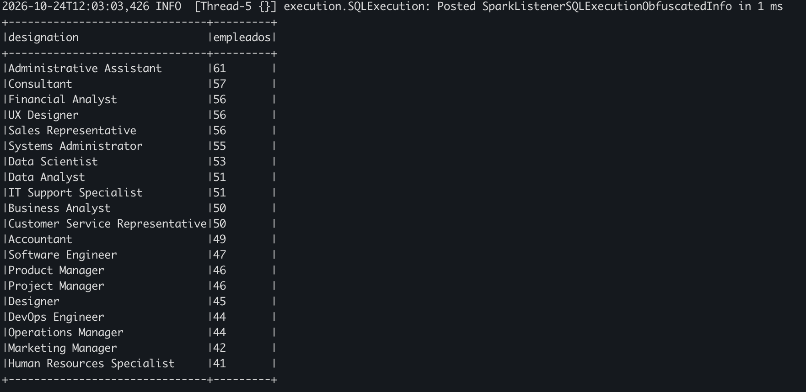
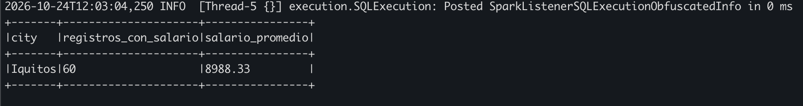

# Trabajo de Spark en Ciencia de Datos Escalable en Universidad Católica San Pablo - Arequipa

## Ingesta de datos
- Con un script de python se generaron datos aleatorios de 1000 usuarios

```bash
emp.csv
```

Las primeras tres priemras filas del archivo son como sigue

```csv
id,name,city,designation,salary
1,Lucia Flores,Santiago,Financial Analyst,10600
2,Ana Sanchez,Bogota,Financial Analyst,9300
3,Fernando Garcia,Iquitos,Accountant,9800
```

Los siguientes pasos se ejecutan **dentro de la sesión SSH**.

```bash
hdfs dfs -mkdir -p /user/hadoop
hdfs dfs -put -f ~/emp.csv /user/hadoop/emp.csv
```



## Creación de la tabla e ingesta de datos en HBase

El siguiente script se encarga de ingestar los datos del csv en una tabla de HBase con sus respectivas column families y columns.

```python
from pyspark.sql import SparkSession
from pyspark.sql.functions import col, trim

spark = SparkSession.builder.appName('CSV a HBase').getOrCreate()

csv_path = 'hdfs:///user/hadoop/emp.csv'

catalog = '''{
  "table": {"namespace": "default", "name": "emp"},
  "rowkey": "id",
  "columns": {
    "id": {"cf": "rowkey", "col": "id", "type": "string"},
    "name": {"cf": "personal", "col": "name", "type": "string"},
    "city": {"cf": "personal", "col": "city", "type": "string"},
    "designation": {"cf": "professional", "col": "designation", "type": "string"},
    "salary": {"cf": "professional", "col": "salary", "type": "string"}
  }
}'''

datos = (
    spark.read
    .option('header', 'true')
    .option('mode', 'FAILFAST')
    .schema('id STRING, name STRING, city STRING, designation STRING, salary STRING')
    .csv(csv_path)
    .select(
        trim(col('id')).alias('id'),
        trim(col('name')).alias('name'),
        trim(col('city')).alias('city'),
        trim(col('designation')).alias('designation'),
        trim(col('salary')).alias('salary')
    )
)

datos.show(truncate=False)

(
    datos.write
    .format('org.apache.hadoop.hbase.spark')
    .option('catalog', catalog)
    .option('newtable', '5')
    .option('hbase.spark.pushdown.columnfilter', 'false')
    .save()
)

leidos = (
    spark.read
    .format('org.apache.hadoop.hbase.spark')
    .option('catalog', catalog)
    .option('hbase.spark.pushdown.columnfilter', 'false')
    .load()
)

leidos.show(truncate=False)

spark.stop()
```

Para ejecutar el script se debe enviar una tarea a spark con el siguiente comando.
Es importante que los JARs esten disponibles. Para ello revisar el archivo de `emr-config.md`

```bash
CONNECTOR_JARS="$HOME/hbase-spark-jars/hbase-spark-1.1.0-SNAPSHOT.jar,$HOME/hbase-spark-jars/hbase-spark-pushdown_2.12-1.1.0-SNAPSHOT.jar,$HOME/hbase-spark-jars/hbase-spark-protocol-shaded-1.1.0-SNAPSHOT.jar"
HBASE_JARS='/usr/lib/hbase/lib/shaded-clients/hbase-shaded-client-byo-hadoop-2.6.4-amzn-2.jar,/usr/lib/hbase/lib/shaded-clients/hbase-shaded-mapreduce-2.6.4-amzn-2.jar'
OTEL_JARS='/usr/lib/hbase/lib/client-facing-thirdparty/opentelemetry-api-1.49.0.jar,/usr/lib/hbase/lib/client-facing-thirdparty/opentelemetry-context-1.49.0.jar,/usr/lib/hbase/lib/opentelemetry-semconv-1.29.0-alpha.jar'

spark-submit \
  --master yarn \
  --deploy-mode client \
  --jars "$CONNECTOR_JARS,$HBASE_JARS,$OTEL_JARS" \
  --conf spark.driver.extraClassPath=/etc/hbase/conf \
  --conf spark.executor.extraClassPath=/etc/hbase/conf \
  --conf 'spark.hadoop.io.compression.codecs=org.apache.hadoop.io.compress.DefaultCodec,org.apache.hadoop.io.compress.GzipCodec,org.apache.hadoop.io.compress.BZip2Codec' \
  ~/load_clients.py
```



## Actividades

### Actividad 4.A
A continuación se desarollan las actividades requeridas en el trabajo

Los siguientes comandos se ejecutan dentro de la sesión de hbase `hbase shell`

1. Verificación de la estructura de la tabla

```bash
describe 'emp'
```



2. Visualización de registros

```bash
scan 'emp'
```



3. Verificación de columnas

Como se puede ver en el output del comando `describe`, las columnas estan correctas y habilitan los analisis posteriores.

### Actividad 4.B

Para responder las preguntas de la actividad se debe ejecutar el siguiente script

```python
from pyspark.sql import SparkSession
from pyspark.sql.functions import (
    col,
    trim,
    count,
    sum as spark_sum,
    avg,
    min as spark_min,
    max as spark_max,
    round as spark_round
)
from pyspark.sql.window import Window

# Crear una sesión de Spark
spark = SparkSession.builder.appName("AnalisisEmpleadosHBase").getOrCreate()

# Definir cómo se mapean las columnas de HBase a columnas de Spark
catalog = '''{
  "table": {"namespace": "default", "name": "emp"},
  "rowkey": "id",
  "columns": {
    "id": {"cf": "rowkey", "col": "id", "type": "string"},
    "name": {"cf": "personal", "col": "name", "type": "string"},
    "city": {"cf": "personal", "col": "city", "type": "string"},
    "designation": {"cf": "professional", "col": "designation", "type": "string"},
    "salary": {"cf": "professional", "col": "salary", "type": "string"}
  }
}'''

# Leer la tabla emp desde HBase
empleados = (spark.read
    .format("org.apache.hadoop.hbase.spark")
    .option("catalog", catalog)
    .option("hbase.spark.pushdown.columnfilter", "false")
    .load())

# Normalizar textos para que los filtros y agrupaciones ignoren espacios sobrantes
empleados = (empleados
    .withColumn("city", trim(col("city")))
    .withColumn("designation", trim(col("designation")))
    .withColumn("salary_num", trim(col("salary")).cast("double"))
)
# 1. ¿Cuántos empleados hay registrados en cada ciudad?
# Se excluyen empleados sin ciudad informada.
print("Empleados por ciudad:")
(empleados
    .filter(col("city").isNotNull() & (col("city") != ""))
    .groupBy("city")
    .agg(count("*").alias("empleados"))
    .orderBy(col("empleados").desc())
    .show(truncate=False))

# 2. ¿Qué porcentaje del total corresponde a cada ciudad?
# El porcentaje se calcula sobre los empleados con ciudad informada.
print("Porcentaje de empleados por ciudad:")
conteo_ciudades = (empleados
    .filter(col("city").isNotNull() & (col("city") != ""))
    .groupBy("city")
    .agg(count("*").alias("empleados")))

ventana_total = Window.rowsBetween(
    Window.unboundedPreceding,
    Window.unboundedFollowing
)

(conteo_ciudades
    .withColumn(
        "porcentaje",
        spark_round(
            col("empleados") * 100 / spark_sum(col("empleados")).over(ventana_total),
            2
        )
    )
    .orderBy(col("porcentaje").desc())
    .show(truncate=False))

# 3. ¿Cuál es el salario promedio, mínimo y máximo?
# Las agregaciones ignoran salarios nulos.
print("Resumen de salarios:")
(empleados
    .agg(
        spark_round(avg("salary_num"), 2).alias("salario_promedio"),
        spark_min("salary_num").alias("salario_minimo"),
        spark_max("salary_num").alias("salario_maximo")
    )
    .show(truncate=False))

# 4. ¿Cuántos empleados hay por cargo?
# Se excluyen empleados sin cargo informado.
print("Empleados por cargo:")
(empleados
    .filter(col("designation").isNotNull() & (col("designation") != ""))
    .groupBy("designation")
    .agg(count("*").alias("empleados"))
    .orderBy(col("empleados").desc())
    .show(truncate=False))

# 5. Si hay suficientes registros, ¿qué ciudad presenta el mayor salario promedio?
# Solo se consideran salarios informados y ciudades con al menos min_registros.
min_registros = 2

promedios_ciudad = (empleados
    .filter(
        col("city").isNotNull() & (col("city") != "") &
        col("salary_num").isNotNull()
    )
    .groupBy("city")
    .agg(
        count("salary_num").alias("registros_con_salario"),
        spark_round(avg("salary_num"), 2).alias("salario_promedio")
    )
    .filter(col("registros_con_salario") >= min_registros)
    .orderBy(col("salario_promedio").desc()))

print("Salario promedio por ciudad (solo ciudades con suficientes registros):")
promedios_ciudad.show(truncate=False)

# Mostrar solo la ciudad con el salario promedio más alto, si existe alguna.
print("Ciudad con mayor salario promedio:")
promedios_ciudad.limit(1).show(truncate=False)

# Cerrar la sesión de Spark
spark.stop()
```

Ejecutar el script con el siguiente comando

```bash
CONNECTOR_JARS="$HOME/hbase-spark-jars/hbase-spark-1.1.0-SNAPSHOT.jar,$HOME/hbase-spark-jars/hbase-spark-pushdown_2.12-1.1.0-SNAPSHOT.jar,$HOME/hbase-spark-jars/hbase-spark-protocol-shaded-1.1.0-SNAPSHOT.jar"
HBASE_JARS='/usr/lib/hbase/lib/shaded-clients/hbase-shaded-client-byo-hadoop-2.6.4-amzn-2.jar,/usr/lib/hbase/lib/shaded-clients/hbase-shaded-mapreduce-2.6.4-amzn-2.jar'
OTEL_JARS='/usr/lib/hbase/lib/client-facing-thirdparty/opentelemetry-api-1.49.0.jar,/usr/lib/hbase/lib/client-facing-thirdparty/opentelemetry-context-1.49.0.jar,/usr/lib/hbase/lib/opentelemetry-semconv-1.29.0-alpha.jar'

spark-submit \
  --master yarn \
  --deploy-mode client \
  --jars "$CONNECTOR_JARS,$HBASE_JARS,$OTEL_JARS" \
  --conf spark.driver.extraClassPath=/etc/hbase/conf \
  --conf spark.executor.extraClassPath=/etc/hbase/conf \
  --conf 'spark.hadoop.io.compression.codecs=org.apache.hadoop.io.compress.DefaultCodec,org.apache.hadoop.io.compress.GzipCodec,org.apache.hadoop.io.compress.BZip2Codec' \
  ~/activity.py
```

Los resultados para cada pregunta se muestran a continuación

1. ¿Cuántos empleados hay registrados en cada ciudad?



2. ¿Qué porcentaje del total corresponde a cada ciudad?



3. ¿Cuál es el salario promedio, mínimo y máximo?



4. ¿Cuántos empleados hay por cargo?



5. Si hay suficientes registros, ¿qué ciudad presenta el mayor salario promedio?



#### Intepretación de resultados
La información registra 1,000 empleados en 18 ciudades, con una distribución relativamente homogénea: las cifras van de 36 empleados en Madrid a 63 en Montevideo y Medellín. Por cargo, los conteos varían entre 41 y 61; Administrative Assistant es el más numeroso y Human Resources Specialist, el menos numeroso.

Iquitos presenta el mayor salario promedio (8,988.33, con 60 registros) y Huancayo el menor (7,296.72, con 61 registros).
La desviación estándar del los salarios es alta debido a la diferencia de ciudades y costo de vida.

### Requisitos Técnicos
El trabajo se realiza usando spark en un cluster EMR 7.14, para habilitar la conexión entre hbase y spark es necesario contar con los JAR del conector `hbase-spark`, para conseguir ello se debe seguir la guía `emr-config.md`

### Análisis conceptual
1. ¿Qué parte del trabajo realiza HBase y qué parte realiza Python?
- HBase (Capa de Almacenamiento y Filtrado Primario): Gestiona la persistencia distribuida en bloques HFiles sobre HDFS. Realiza la búsqueda de bloques, el filtrado por columnas solicitadas (column families/qualifiers) y aplica el tamaño de lote (batching) para reducir la cantidad de celdas transmitidas sobre la red.

- Python (Capa de Aplicación y Agregación): Recibe los datos filtrados mediante el protocolo Thrift, realiza el parseo de bytes a UTF-8, ejecuta la conversión de tipos (string a float), descarta valores nulos o corruptos y efectúa los cálculos estadísticos (medias, máximos, mínimos y agrupaciones).

2. ¿Por qué get es adecuado para recuperar una fila conocida y scan para recorrer varias filas?

- Operación Get (Acceso Puntual - O(1) aprox.): Utiliza la clave primaria (Row Key) para consultar directamente la tabla de metadatos hbase:meta, identificando el RegionServer y la MemStore/HFile exactos. Evita lecturas innecesarias en disco, siendo ideal para recuperar un registro único por ID.

- Operación Scan (Lectura Secuencial por Rangos - O(N)): Recorre las filas ordenadas lexicográficamente entre un startRow y stopRow. Es imprescindible cuando se requiere procesar un conjunto masivo de registros o realizar agregaciones globales donde los IDs no se conocen de antemano.

3. ¿Qué limitaciones tendría recuperar toda una tabla grande para procesarla en un único programa?

- Saturación de Red (Network Bottleneck): Transferir gigabytes o terabytes de datos no estructurados desde los RegionServers al nodo cliente ahoga el ancho de banda del clúster.

- Agotamiento de Memoria (Out of Memory - OOM): Un DataFrame de Pandas en un único nodo cliente intenta cargar toda la estructura en RAM, provocando el colapso del proceso al exceder la capacidad del sistema.

4. ¿Cómo cambiaría la solución si se necesitara procesar millones de registros de manera distribuida?

- Spark mapea la tabla HBase como un DataFrame distribuido. Asigna una partición de Spark a cada región de HBase, permitiendo que múltiples Workers lean y procesen de forma paralela en memoria. Las agregaciones y filtros se ejecutan de manera distribuida mediante transformaciones map-reduce en paralelo, reduciendo drásticamente el tiempo de ejecución de horas a segundos.

- Este proyecto usa Apache Spark en AWS EMR en conjunto con HBase