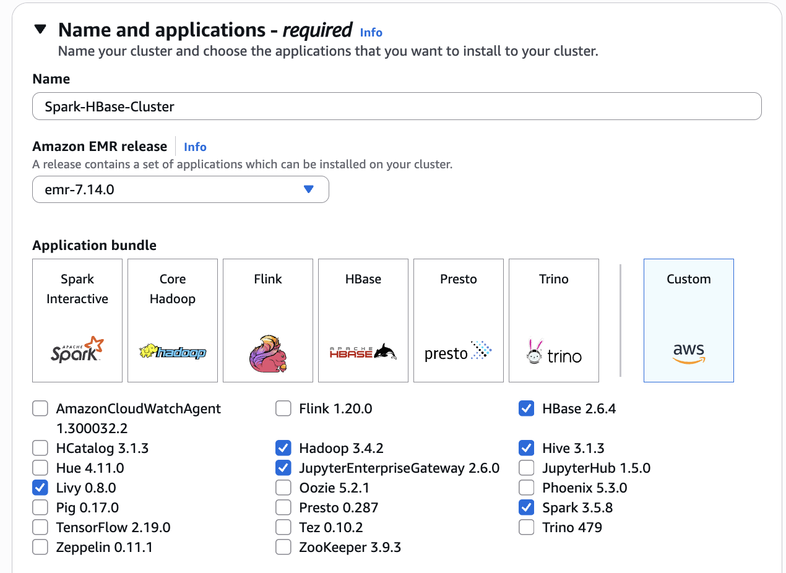
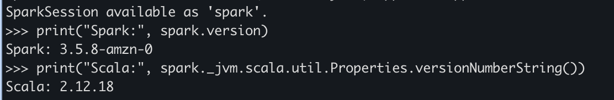
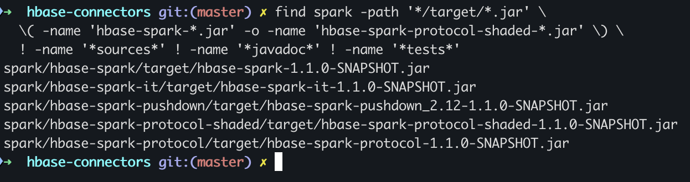
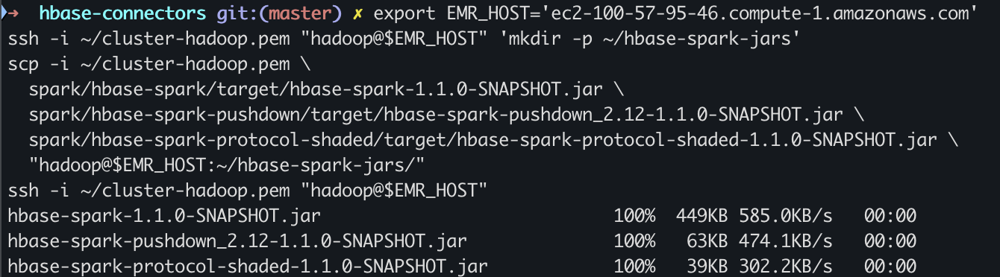

# Setup para usar Hbase desde Spark como un dataframe

## Creación del cluster en AWS EMR



- Cluster configurado: emr-7.14

## Verificación de versiones

Conectarse al nodo principal del cluster usando la key e IP correcta

```bash
ssh -i ~/cluster-hadoop.pem hadoop@ec2-100-57-95-46.compute-1.amazonaws.com
```

Entrar al shell de spark 
```bash
pyspark
```

Dentro del shell interactivo ejecutar los comandos

```py
print("Spark:", spark.version)
print("Scala:", spark._jvm.scala.util.Properties.versionNumberString())
```




Las versiones configuradas son las siguientes
- Spark: 3.5.8
- Scala: 2.12.18
- Hadoop: 3.4.2
- HBase: 2.6.4


## Compilar el conector fuera de EMR

Es posible usar el conector `hbase-spark` para permitir que las tablas de hbase puedan ser tratadas como dataframes en spark.
El cluster EMR no ofrece los JAR requeridos para usar el conector por lo que es necesario generarlos y habilitarlos en el cluster EMR. Este conector se debe crear en base a las versiones anteriormente descubiertas. 

La estrategia es compilar localmente los JAR y luego copiarlos al cluster.

### Clonar el repositorio de hbase connectors

Se usa la última versión del repositorio con el commit `201a9417cc86498fcc353c10c81a86c79778df67` para asegurar reproducibilidad en el tutorial.

```bash
git clone https://github.com/apache/hbase-connectors.git
git checkout 201a9417cc86498fcc353c10c81a86c79778df67
cd hbase-connectors
```

### Reemplazar código para la compilación
La versión del código utilizada genera `1.1.0-SNAPSHOT`. Con Spark 3.5, este código necesitó retirar la referencia obsoleta a `StaticLoggerBinder`:

```bash
python3 - <<'PY'
from pathlib import Path
p = Path('spark/hbase-spark/src/main/scala/org/apache/hadoop/hbase/spark/Logging.scala')
s = p.read_text()
old_import = 'import org.slf4j.impl.StaticLoggerBinder\n'
old_line = '    val binderClass = StaticLoggerBinder.getSingleton.getLoggerFactoryClassStr\n'
assert s.count(old_import) == 1 and s.count(old_line) == 1
p.write_text(s.replace(old_import, '').replace(old_line, ''))
PY
```

### Ejecutar la compilación en un contenedor Docker

Se usa las mismas versiones descubiertas anteriormente.

```bash
docker run --rm \
  -v "$PWD:/work" -w /work/spark \
  maven:3.9.9-eclipse-temurin-17 \
  mvn -Dspark.version=3.5.8 \
      -Dscala.version=2.12.18 \
      -Dscala.binary.version=2.12 \
      -Dhadoop-three.version=3.4.2 \
      -Dhbase.version=2.6.4 \
      -Dmaven.test.skip=true \
      clean install
```

Confirmar `BUILD SUCCESS`. Se usarán estos tres artefactos: `hbase-spark`, `hbase-spark-pushdown_2.12` y `hbase-spark-protocol-shaded`. No se necesita el JAR `hbase-spark-it` para ejecutar la carga.

Para verificar que los JAR se generaron correctamente, ejecuta el siguiente comando

```bash
find spark -path '*/target/*.jar' \
  \( -name 'hbase-spark-*.jar' -o -name 'hbase-spark-protocol-shaded-*.jar' \) \
  ! -name '*sources*' ! -name '*javadoc*' ! -name '*tests*'
```

En este caso se obtienen los siguientes archivos



```bash
spark/hbase-spark/target/hbase-spark-1.1.0-SNAPSHOT.jar
spark/hbase-spark-it/target/hbase-spark-it-1.1.0-SNAPSHOT.jar
spark/hbase-spark-pushdown/target/hbase-spark-pushdown_2.12-1.1.0-SNAPSHOT.jar
spark/hbase-spark-protocol-shaded/target/hbase-spark-protocol-shaded-1.1.0-SNAPSHOT.jar
spark/hbase-spark-protocol/target/hbase-spark-protocol-1.1.0-SNAPSHOT.jar
```

## Copiar los JAR al nodo principal

Configurar la dirección pública actual del nodo principal y usar la misma llave privada de la conexión SSH:

```bash
export EMR_HOST='ec2-100-57-95-46.compute-1.amazonaws.com'
ssh -i ~/cluster-hadoop.pem "hadoop@$EMR_HOST" 'mkdir -p ~/hbase-spark-jars'
scp -i ~/cluster-hadoop.pem \
  spark/hbase-spark/target/hbase-spark-1.1.0-SNAPSHOT.jar \
  spark/hbase-spark-pushdown/target/hbase-spark-pushdown_2.12-1.1.0-SNAPSHOT.jar \
  spark/hbase-spark-protocol-shaded/target/hbase-spark-protocol-shaded-1.1.0-SNAPSHOT.jar \
  "hadoop@$EMR_HOST:~/hbase-spark-jars/"
ssh -i ~/cluster-hadoop.pem "hadoop@$EMR_HOST"
```

